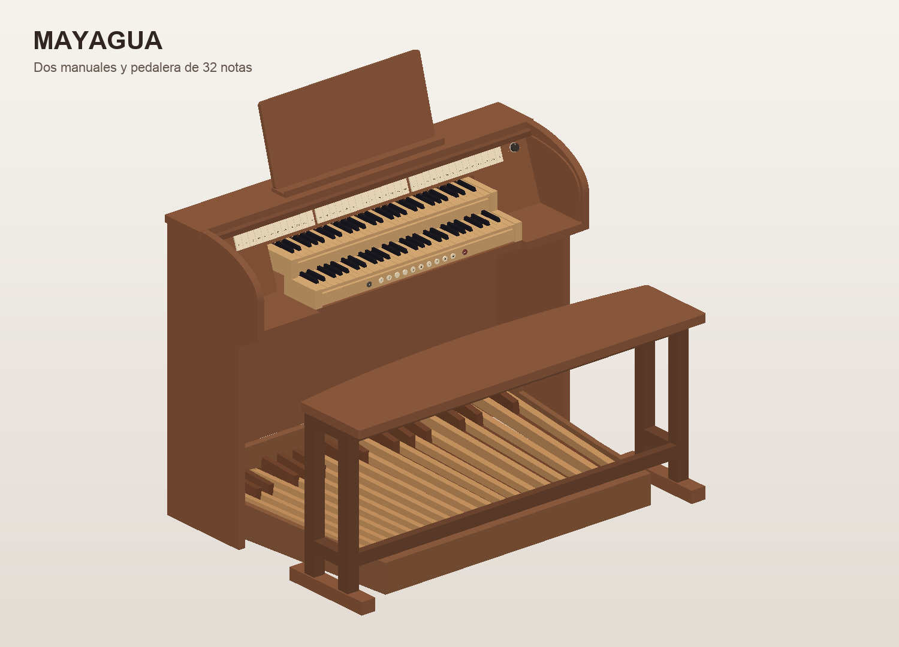

# Mayagua · Órgano MIDI

**Un proyecto personal de música, ingeniería y fe.**

Diseño y construcción de un órgano MIDI con dos manuales de 56 teclas cada uno, una pedalera cóncava radial de 32 notas, consola de madera y controles para órganos virtuales.

## ¿Qué es Mayagua?

Mayagua es un proyecto personal que nace de mi pasión por el órgano, mi formación técnica y el deseo de construir un instrumento propio.

Soy organista de la Catedral de Querétaro desde 2019. Durante estos años he tenido la oportunidad de conocer de cerca tanto la belleza del instrumento como algunas de las dificultades que enfrenta su práctica en nuestra ciudad.

En Querétaro quedan pocos órganos tubulares y, de los que todavía existen, varios no se encuentran en condiciones de funcionamiento óptimas. Por otro lado, adquirir un órgano litúrgico de una marca reconocida representa una inversión considerable, lo que dificulta el acceso a este tipo de instrumentos.

Esta situación me llevó a preguntarme si sería capaz de construir mi propio órgano.

Además de músico, soy técnico mecatrónico e ingeniero de software. Mayagua representa la oportunidad de reunir estas tres disciplinas en un mismo proyecto y llevar mis conocimientos al límite, desde el diseño mecánico y la carpintería hasta la electrónica, la programación y la integración MIDI.

No se trata solamente de conseguir un instrumento más económico. Quiero comprender su funcionamiento, diseñar sus componentes y enfrentar personalmente los problemas que implica construirlo.

## ¿Por qué Mayagua?

Mayagua es el apellido de mi esposa.

Decidí darle su nombre a este proyecto como una forma de reconocer a la mujer que me acompaña, me apoya y constantemente me anima a continuar sirviendo a Dios a través de la música.

Su apoyo ha sido fundamental para seguir desarrollándome como músico y para atreverme a emprender proyectos como este.

También quiero que Mayagua sea una expresión de gratitud a Dios por los dones y oportunidades que me ha regalado, por permitirme dedicar parte de mi vida a la música y por haber puesto en mi camino a una mujer maravillosa con quien compartirla.

Creo que los conocimientos y las capacidades que recibimos adquieren un sentido más profundo cuando los ponemos al servicio de los demás.

Desde mi fe, entiendo también la trascendencia como una parte fundamental de nuestra existencia y de nuestra búsqueda de la vida eterna. Me gustaría que el trabajo que realice durante mi vida pueda dejar algo positivo en otras personas.

De alguna manera, Mayagua es mi intento de reunir todo eso en una misma obra.

## Una motivación que va más allá de construir un instrumento

El primer órgano Mayagua será para mí.

Quiero utilizarlo como una prueba personal de mis capacidades y descubrir hasta dónde puedo llegar combinando mis conocimientos musicales, mecánicos, electrónicos y de programación.

Sin embargo, hay una aspiración mucho más grande detrás del proyecto.

Me gustaría que algún día Querétaro fuera reconocido por la calidad de sus organistas, que más jóvenes se interesaran por estudiar el instrumento y que existieran mejores oportunidades para aprenderlo y practicarlo.

Creo que una de las dificultades para fomentar el estudio del órgano es precisamente la falta de instrumentos accesibles.

Si en el futuro consigo desarrollar instrumentos que puedan contribuir a la formación de nuevos organistas, sentiré que este proyecto habrá cumplido un propósito mucho mayor que el de construir mi propia consola.

También tengo un sueño particularmente importante: algún día poder construir personalmente el órgano para la nueva Catedral de Querétaro, cuyo edificio se encuentra en construcción.

Sé que es una aspiración ambiciosa y que todavía existe una enorme distancia entre este primer prototipo y un proyecto de esa magnitud. Pero me gustaría que Mayagua fuera el primer paso para adquirir la experiencia y los conocimientos necesarios para intentarlo.

## Filosofía del proyecto

Desde el principio decidí que quería construir la mayor cantidad posible de componentes por mi cuenta.

Esto significa diseñar y fabricar las teclas, sus mecanismos, la pedalera, la consola y los controles, procurando utilizar materiales accesibles y herramientas que pueda manejar en un pequeño taller.

No pretendo que la primera versión sea perfecta ni que todos los mecanismos funcionen correctamente desde el primer intento.

Por el contrario, considero que una parte fundamental de este proyecto será experimentar, cometer errores, corregirlos y aprender de ellos.

Mis principales objetivos son:

- **Aprender haciendo:** llevar los conocimientos teóricos a problemas reales de diseño y fabricación.
- **Integrar disciplinas:** combinar música, mecatrónica, electrónica, carpintería y desarrollo de software.
- **Buscar soluciones accesibles:** utilizar componentes y procesos que no dependan necesariamente de maquinaria industrial.
- **Diseñar para el mantenimiento:** procurar que los mecanismos puedan desmontarse, ajustarse y repararse.
- **Documentar el proceso:** conservar tanto las soluciones exitosas como los errores y modificaciones.
- **Compartir conocimientos:** permitir que otras personas puedan consultar el desarrollo y aportar sus propias ideas.

Mayagua no pretende reinventar el órgano ni reemplazar la tradición organera. Busca aprovechar las posibilidades de la tecnología actual para acercar este instrumento a más personas.

## Características del diseño

| Componente | Descripción |
| --- | --- |
| Manuales | 2 teclados de 56 notas cada uno |
| Pedalera | 32 notas, de Do a Sol |
| Geometría de pedalera | Cóncava radial, con referencias BDO |
| Consola | Construcción en madera |
| Banco | Banco para organista |
| Registros | Controles físicos para registros virtuales |
| Combinaciones | Controles para memorias y funciones del órgano |
| Expresión | Pedales de control |
| Comunicación | MIDI |
| Software previsto | GrandOrgue / Hauptwerk |
| Modelado | OpenSCAD |

Estas características corresponden al diseño actual y podrán modificarse conforme avance la fabricación.

## Diseño y modelado 3D

La primera etapa del proyecto consistió en diseñar digitalmente el instrumento completo.

Para ello utilicé principalmente **OpenSCAD**, un programa de modelado tridimensional que permite definir geometrías mediante código y parámetros.

Elegí este enfoque porque me permite controlar con precisión las dimensiones, separaciones, radios y posiciones de los componentes, además de realizar modificaciones sin tener que reconstruir todo el modelo.

Durante esta etapa he trabajado en la distribución de los manuales, las geometrías de las teclas, la pedalera cóncava radial, la estructura de la consola, el banco y los distintos controles.

El proceso ha requerido numerosas pruebas y correcciones, especialmente en los mecanismos de las teclas y las relaciones geométricas entre los componentes.

El modelo tridimensional está terminado en su primera versión, aunque todavía será necesario validar físicamente las piezas y realizar los ajustes que surjan durante la construcción.

### Abrir el modelo

1. Abre [organo_completo.scad](organo_completo.scad) en OpenSCAD. Conserva la estructura de carpetas para que se carguen los modelos incluidos. No hacen falta bibliotecas externas.
2. Presiona **F5** para previsualizar el conjunto o **F6** para renderizarlo.
3. Utiliza el panel **Personalizador** para mostrar u ocultar componentes y modificar parámetros como la apertura de la persiana de la consola (`apertura_secreter`).

Todas las dimensiones están expresadas en milímetros.

Para inspeccionar componentes individuales:

- [Modelo de los manuales](modelos/manuales.scad)
- [Modelo de la pedalera](modelos/pedalera_recortada.scad)
- [Render del panel de registros](output/imagenes/organo_registros.png)

## Planos de las teclas

Los [planos P01–P10](planos/manuales/teclas) incluyen las geometrías de las teclas naturales, los cuerpos de las sostenidas y sus tapas.

La [tabla de cantidades](planos/manuales/teclas/tabla_cantidades.svg) indica cuántas piezas se requieren para fabricar uno o dos manuales.

Para imprimir, utiliza papel A4 horizontal al 100 % y consulta la escala indicada en cada vista.

Las cotas están expresadas en milímetros.

**Estos planos todavía no han sido validados mediante la fabricación de un teclado completo.** Pueden modificarse conforme se realicen las primeras pruebas mecánicas.

## Electrónica y comunicación MIDI

Mayagua está pensado para funcionar como un controlador MIDI conectado a software de órganos virtuales.

Los manuales y la pedalera deberán contar con mecanismos de detección para identificar la pulsación y liberación de cada tecla.

También se contempla la integración de controles físicos para registros, combinaciones, expresión y otras funciones del instrumento.

Por ahora se han desarrollado distintas propuestas de cableado para los manuales.

| Esquema | Contenido |
| --- | --- |
| [Matriz para Arduino Nano clásico](output/esquemas/esquema_nano_112_teclas.svg) | Matriz de 8 filas por 14 columnas para los 112 contactos, con diodos 1N4148 y decodificador 74HC138 |
| [Distribución física para Nano](output/esquemas/esquema_nano_distribucion_fisica.svg) | Ubicación de los contactos y asignación de filas y columnas |
| [Cableado para Arduino Due](output/esquemas/cableado_completo_due_dos_manuales.svg) | Distribución de contactos y asignación de pines para la versión con Due |

El repositorio todavía no incluye firmware MIDI ni un esquema definitivo de cableado para la pedalera.

## La pedalera

La pedalera tendrá 32 notas, desde Do hasta Sol, con disposición cóncava y radial.

Para desarrollar su geometría he consultado referencias de construcción de órganos, especialmente las relacionadas con los estándares BDO y AGO.

El modelo actual toma como referencia radios BDO, pero no representa una certificación dimensional completa del estándar.

Los planos definitivos de fabricación y la validación física de la pedalera siguen pendientes.

## Estado del proyecto

**Noviembre de 2026 — Primera versión del modelado 3D terminada.**

Actualmente me encuentro preparando el inicio de la construcción física.

El siguiente paso es adquirir algunas herramientas de carpintería que todavía me hacen falta y comenzar a fabricar los primeros componentes.

### Avance

- [x] Definición general del instrumento.
- [x] Modelado de los dos manuales.
- [x] Modelado de la pedalera.
- [x] Diseño general de la consola.
- [x] Modelado del banco y controles.
- [x] Primeros planos de las teclas.
- [x] Propuestas de cableado de los manuales.
- [ ] Adquisición de herramientas pendientes.
- [ ] Fabricación y pruebas de los primeros mecanismos.
- [ ] Construcción de los manuales.
- [ ] Construcción de la pedalera.
- [ ] Fabricación de la consola y el banco.
- [ ] Integración electrónica.
- [ ] Desarrollo del firmware MIDI.
- [ ] Pruebas con órganos virtuales.
- [ ] Ajustes y puesta en funcionamiento.

La lista representa el estado general del proyecto y se actualizará conforme avance.

## ¿Por qué este repositorio es público?

Decidí mantener público este repositorio para que cualquier persona interesada pueda seguir libremente el desarrollo de Mayagua.

No es necesario ser organista ni tener conocimientos avanzados de ingeniería para participar. Si alguien tiene curiosidad por el proyecto, quiere conocer cómo estoy resolviendo algún mecanismo o simplemente desea observar su evolución, puede hacerlo.

También me interesa recibir ideas, recomendaciones y observaciones de otras personas, especialmente de quienes tengan experiencia en construcción de instrumentos, carpintería, electrónica o programación.

Los modelos, planos y esquemas se comparten como parte de un proceso de experimentación.

**Cualquier persona puede consultarlos y utilizarlos bajo su propia responsabilidad, teniendo presente que ninguno debe considerarse todavía un diseño final o completamente validado.**

Es probable que algunos componentes cambien considerablemente durante la fabricación.

Si decides utilizar alguno de estos archivos, te recomiendo revisar las dimensiones, comprobar los mecanismos y realizar tus propias pruebas antes de fabricar piezas definitivas.

La publicación del repositorio permite conocer el proceso y colaborar con él. Las condiciones formales de reutilización, modificación y distribución deberán establecerse en el archivo de licencia correspondiente.

## Comentarios y aportaciones

Cualquier comentario, corrección o sugerencia es bienvenido.

Si encuentras un error, tienes alguna propuesta de mejora o conoces una solución que pueda resultar útil, puedes abrir una *Issue* en este repositorio.

No tengo todas las respuestas y estoy convencido de que muchas de las mejores soluciones surgirán durante la construcción, posiblemente gracias también a las aportaciones de otras personas.

Mi intención es documentar el camino completo, incluyendo las decisiones que resulten equivocadas y las soluciones que termine descartando.

## Una mirada al futuro

Por ahora, Mayagua es un proyecto personal y experimental.

Mi prioridad es construir mi primer instrumento, conseguir que funcione correctamente y aprender todo lo posible durante el proceso.

Sin embargo, me gustaría que este esfuerzo pudiera convertirse algún día en algo más grande: una iniciativa mexicana capaz de contribuir al desarrollo y la formación de nuevos organistas.

Me ilusiona pensar que, con el tiempo, los conocimientos adquiridos aquí puedan servir para construir otros instrumentos y facilitar que más personas se acerquen al órgano.

No sé hasta dónde llegará este proyecto, pero sí tengo claro por qué quiero intentarlo.

Si algún día Mayagua contribuye a que un joven descubra el órgano, a que un estudiante tenga un instrumento donde practicar o a que una iglesia pueda contar con música de órgano, habrá valido la pena todo el esfuerzo.

---

*Mayagua es un proyecto personal desarrollado en Querétaro, México.*

*Dedicado a mi esposa, por su amor y apoyo incondicional, y como agradecimiento a Dios por los dones que me ha confiado y la oportunidad de ponerlos a su servicio.*